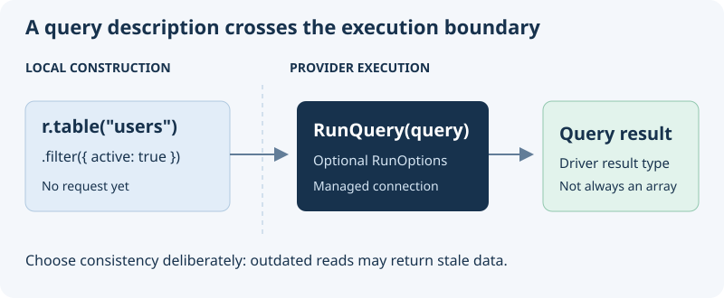

# Query RethinkDB through a managed connection

## Overview

Build a native RethinkDB query with `r`, then execute it through `RunQuery` on a provider-managed connection. The interface re-exports the [rethinkdb-ts](https://github.com/rethinkdb/rethinkdb-ts) query builder; it does not introduce a second query language.

## Build first, execute second

{width="480"}

Choose the operation you need:

- [Create, retrieve, update, or delete documents](#crud-operations).
- [Set read and durability options](#query-options) for one execution.
- [Join or aggregate records](#advanced-queries) with native query expressions.
- Look up the two exports: [`r`](#r-query-builder) and [`RunQuery`](#runquery).

Configure an implementing module and a reachable RethinkDB database before executing queries. The examples assume a `users` table in the configured default database. The join example also needs a `posts` table with an `authorId` secondary index. Installing this interface creates neither tables nor indexes.

## Getting Started

Install the package in your project:

```bash
pnpm add @antelopejs/interface-rethinkdb
```

### Read one record first

Run this in an AntelopeJS module bound to a RethinkDB provider. Pass an existing ID from the `users` table; a missing ID returns `null`.

```typescript
import { RunQuery, r } from "@antelopejs/interface-rethinkdb";

export async function readUser(id: string) {
  const user = await RunQuery(r.table("users").get(id));
  if (user === null) return "User not found";
  return user;
}
```

Building the query does not read the record; `RunQuery` executes it. Native queries do not apply AQL model modifiers or Data API field permissions, so do not expose the entire record as an HTTP response without selecting public fields.

## `r` (Query Builder)

The `r` object is the RethinkDB query builder, re-exported directly from the `rethinkdb-ts` package. Use it to construct queries that you then execute with `RunQuery`.

```typescript
import { r } from "@antelopejs/interface-rethinkdb";

// Build a query (does not execute it)
const query = r.table("users").filter({ active: true });
```

## `RunQuery`

The `RunQuery` function executes a RethinkDB query against the managed connection. It accepts a query built with `r` and optional run options.

```typescript
import { RunQuery, r } from "@antelopejs/interface-rethinkdb";

const result = await RunQuery(r.table("users").get("123"));
```

| Parameter | Type         | Description                                                  |
| --------- | ------------ | ------------------------------------------------------------ |
| `query`   | `RQuery`     | A RethinkDB query built using the `r` query builder          |
| `options` | `RunOptions` | Optional execution settings (e.g., `readMode`, `durability`) |

The function returns a promise of the result type that matches the query's `run()` return type. It delegates execution to the provider rather than opening a connection itself. Do not assume every query returns an array: consume results according to the driver's query type.

## CRUD Operations

### Insert documents

```typescript
import { RunQuery, r } from "@antelopejs/interface-rethinkdb";

async function createUser(name: string, email: string) {
  const result = await RunQuery(
    r.table("users").insert({ name, email, createdAt: r.now() }),
  );
  const id = result.generated_keys?.[0];
  if (result.errors || !id) {
    throw new Error(
      result.first_error ?? "Insert did not return a generated key",
    );
  }
  return id;
}
```

### Retrieve documents

```typescript
import { RunQuery, r } from "@antelopejs/interface-rethinkdb";

async function getUser(id: string) {
  return RunQuery(r.table("users").get(id));
}

async function getActiveUsers() {
  return RunQuery(r.table("users").filter({ active: true }));
}
```

### Update documents

```typescript
import { RunQuery, r } from "@antelopejs/interface-rethinkdb";

async function updateEmail(userId: string, newEmail: string) {
  const result = await RunQuery(
    r.table("users").get(userId).update({ email: newEmail }),
  );
  if (result.errors) throw new Error(result.first_error ?? "Update failed");
  return {
    updated: result.replaced,
    unchanged: result.unchanged,
    skipped: result.skipped,
  };
}
```

Check the write result even when the promise resolves: RethinkDB can report write errors in `errors` and `first_error`. `unchanged` means the value already matched; `skipped` includes a missing record. Neither is the same as a modified record.

### Delete documents

```typescript
import { RunQuery, r } from "@antelopejs/interface-rethinkdb";

async function deleteUser(userId: string) {
  const result = await RunQuery(r.table("users").get(userId).delete());
  if (result.errors) throw new Error(result.first_error ?? "Delete failed");
  return result.deleted;
}
```

The returned count is the number of deleted records. Also handle rejected promises; inspecting `errors` does not replace exception handling.

## Query Options

Pass `RunOptions` as the second argument to control query execution behavior. `readMode: "outdated"` permits stale reads; choose it only when the application can tolerate them, not for decisions that require current data.

```typescript
import { RunQuery, r } from "@antelopejs/interface-rethinkdb";

// Use outdated reads for better performance when strong consistency is not needed
const users = await RunQuery(r.table("users").filter({ role: "admin" }), {
  readMode: "outdated",
});
```

## Advanced Queries

### Joins

```typescript
import { RunQuery, r } from "@antelopejs/interface-rethinkdb";

async function getUsersWithPosts() {
  return RunQuery(
    r.table("users").eqJoin("id", r.table("posts"), { index: "authorId" }),
  );
}
```

### Aggregations

```typescript
import { RunQuery, r } from "@antelopejs/interface-rethinkdb";

async function countUsersByRole() {
  return RunQuery(r.table("users").group("role").count());
}
```

For the complete query builder API, refer to the [RethinkDB documentation](https://rethinkdb.com/api/) and the [rethinkdb-ts package](https://github.com/rethinkdb/rethinkdb-ts).
