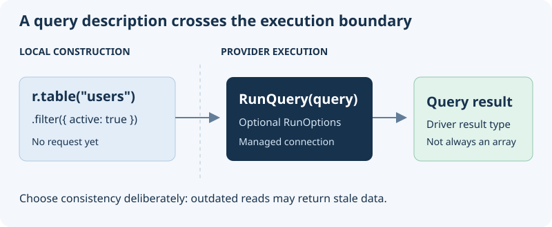

## Overview

Build a native RethinkDB query with `r`, then run it with `RunQuery` on a connection that the implementing module manages. The interface re-exports the [rethinkdb-ts](https://github.com/rethinkdb/rethinkdb-ts) query builder. It adds no second query language.

## Build first, execute second

{width="480"}

Choose the operation you need:

- [Create, retrieve, update, or delete documents](#create-read-update-and-delete-documents).
- [Set read and durability options](#query-options) for one run.
- [Join or aggregate records](#advanced-queries) with native query expressions.
- Look up the two exports, [`r`](#r-query-builder) and [`RunQuery`](#runquery).

Before you run a query, configure an implementing module and a RethinkDB server that it can reach. The examples assume a `users` table in the default database of that module's connection. The join example also needs a `posts` table with an `authorId` secondary index. This interface creates no tables and no indexes.

## Getting started

Install the package in your project:

```bash
pnpm add @antelopejs/interface-rethinkdb
```

### Read one record first

Run this code in an AntelopeJS module bound to a RethinkDB provider. Pass an ID from the `users` table. RethinkDB returns `null` for an ID that the table does not hold.

```typescript
import { RunQuery, r } from "@antelopejs/interface-rethinkdb";

export async function readUser(id: string) {
  const user = await RunQuery(r.table("users").get(id));
  if (user === null) return "User not found";
  return user;
}
```

Building the query does not read the record. `RunQuery` runs it. A native query skips the field modifiers of `@antelopejs/interface-database-decorators` models and the field permissions of `@antelopejs/interface-data-api`. Select the public fields before you send a record in an HTTP response.

## `r` (query builder)

`r` is the RethinkDB query builder of the `rethinkdb-ts` package, re-exported unchanged. Build a query with it, then run the query with `RunQuery`.

```typescript
import { r } from "@antelopejs/interface-rethinkdb";

// Build a query (does not run it)
const query = r.table("users").filter({ active: true });
```

`r.table<User>("users")` types the rows inside the query you build, for example in a `filter` callback. It does not type the result of `RunQuery`.

## `RunQuery`

`RunQuery` runs a RethinkDB query on the managed connection. It takes a query built with `r` and optional run options.

```typescript
import { RunQuery, r } from "@antelopejs/interface-rethinkdb";

const result = await RunQuery(r.table("users").get("123"));
```

| Parameter | Type                    | Description                                        |
| --------- | ----------------------- | -------------------------------------------------- |
| `query`   | `RQuery`                | A RethinkDB query built with the `r` query builder |
| `options` | `RunOptions` (optional) | Run settings, such as `readMode` and `durability`  |

`RunQuery` returns `Promise<QueryResult>`. `QueryResult` is any value a query can resolve to: a JSON value, a `Date`, bytes, or `undefined`. The module that implements the interface runs the query, and the interface cannot check its answer against the query, so `RunQuery` does not promise the type of the query's own `run()`. Narrow the result before you read a field. A stream query such as `filter` gives an array, and `get` gives one row or `null`.

`RunQuery` does not open a connection. It hands the query to the module that implements the interface. The behaviour below belongs to that provider, `@antelopejs/rethinkdb` (its `src/index.ts` and `src/connection.ts`):

- It opens one connection, direct or pooled, when the module is constructed. Every `RunQuery` call from every module runs on that connection. It closes the connection when the module is destroyed.
- It reads a cursor to the end before the promise resolves, so a stream result arrives as a complete array.
- It implements this interface only in its default `owned` mode. An instance in `external` mode does not implement `@antelopejs/interface-rethinkdb`.

## Create, read, update, and delete documents

The examples below read write results through one guard. It checks the `errors` count that every RethinkDB write result carries.

```typescript
import type { QueryResult } from "@antelopejs/interface-rethinkdb";
import type { WriteResult } from "rethinkdb-ts";

function isWriteResult(
  result: QueryResult,
): result is QueryResult & WriteResult {
  return (
    typeof result === "object" &&
    result !== null &&
    "errors" in result &&
    typeof result.errors === "number"
  );
}
```

### Insert documents

```typescript
import { RunQuery, r } from "@antelopejs/interface-rethinkdb";

async function createUser(name: string, email: string) {
  const result = await RunQuery(
    r.table("users").insert({ name, email, createdAt: r.now() }),
  );
  if (!isWriteResult(result))
    throw new Error("Insert returned no write result");
  const id = result.generated_keys?.[0];
  if (result.errors || !id) {
    throw new Error(
      result.first_error ?? "Insert did not return a generated key",
    );
  }
  return id;
}
```

### Retrieve documents

```typescript
import { RunQuery, r } from "@antelopejs/interface-rethinkdb";

async function getUser(id: string) {
  return RunQuery(r.table("users").get(id));
}

async function getActiveUsers() {
  return RunQuery(r.table("users").filter({ active: true }));
}
```

### Update documents

```typescript
import { RunQuery, r } from "@antelopejs/interface-rethinkdb";

async function updateEmail(userId: string, newEmail: string) {
  const result = await RunQuery(
    r.table("users").get(userId).update({ email: newEmail }),
  );
  if (!isWriteResult(result))
    throw new Error("Update returned no write result");
  if (result.errors) throw new Error(result.first_error ?? "Update failed");
  return {
    updated: result.replaced,
    unchanged: result.unchanged,
    skipped: result.skipped,
  };
}
```

Check the write result even when the promise resolves. RethinkDB can report write errors in `errors` and `first_error`. `unchanged` counts records whose value already matched, and `skipped` includes missing records. Neither one is a modified record.

### Delete documents

```typescript
import { RunQuery, r } from "@antelopejs/interface-rethinkdb";

async function deleteUser(userId: string) {
  const result = await RunQuery(r.table("users").get(userId).delete());
  if (!isWriteResult(result))
    throw new Error("Delete returned no write result");
  if (result.errors) throw new Error(result.first_error ?? "Delete failed");
  return result.deleted;
}
```

`deleted` is the number of deleted records. Also handle a rejected promise. A check of `errors` does not replace exception handling.

## Query options

To control how one query runs, pass `RunOptions` as the second argument. `readMode` takes `"single"`, `"majority"`, or `"outdated"`. `"outdated"` allows stale reads. Use it only when the application can accept them, never for a decision that needs current data.

```typescript
import { RunQuery, r } from "@antelopejs/interface-rethinkdb";

// This list can accept stale reads
const users = await RunQuery(r.table("users").filter({ role: "admin" }), {
  readMode: "outdated",
});
```

## Advanced queries

### Joins

```typescript
import { RunQuery, r } from "@antelopejs/interface-rethinkdb";

async function getUsersWithPosts() {
  return RunQuery(
    r.table("users").eqJoin("id", r.table("posts"), { index: "authorId" }),
  );
}
```

### Aggregations

```typescript
import { RunQuery, r } from "@antelopejs/interface-rethinkdb";

async function countUsersByRole() {
  return RunQuery(r.table("users").group("role").count());
}
```

For the complete query builder API, see the [RethinkDB documentation](https://rethinkdb.com/api/) and the [rethinkdb-ts package](https://github.com/rethinkdb/rethinkdb-ts).
